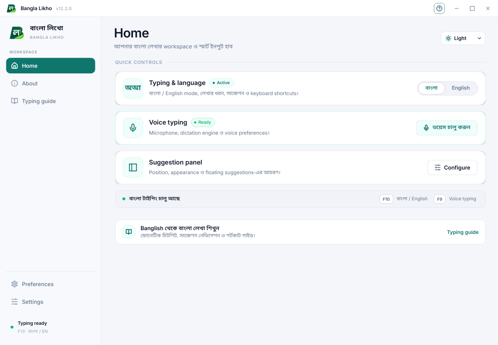
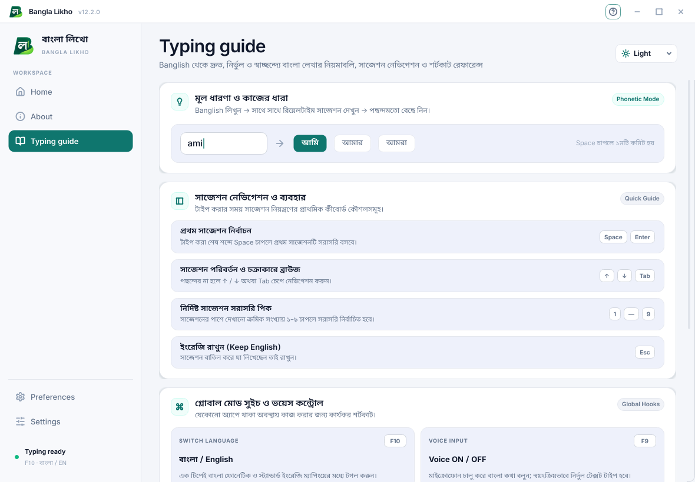

# বাংলা লিখো · Bangla Likho

**Intelligent Bengali phonetic typing, suggestions and voice input for your desktop.**

Write *Banglish* — type `ami` and get **আমি**. Bangla Likho turns phonetic Roman
input into Bengali in any application, with context-aware suggestions right at
the caret, an optional microphone, and a calm, native-feeling interface.

[](https://github.com/shishirapple/Bangla-Likho/actions/workflows/ci.yml)
[](LICENSE)


---

## Features

- **Phonetic typing everywhere** — works in browsers, editors, chat apps and terminals.
- **Local suggestions** — a 24k-word Bengali lexicon, morphology and a small
  n-gram context model, all on your machine. No typing data leaves the device.
- **Adaptive learning** — the spellings and words you pick are remembered locally.
- **Voice dictation** (optional) — Google recognition with explicit consent, or
  local Whisper if you install a model.
- **Three appearances** — Light, Dark or follow the system.
- **Bilingual interface** — Bengali and English side by side.
- **Small footprint** — about 105 MB installed, ~100 MB idle RAM; the voice stack
  loads only when you first use it.
- **Open build** — reproducible scripts for Windows and Linux, and a CI pipeline
  that runs the test suite on both.

| Home | Typing guide |
|---|---|
|  |  |

---

## Install

### Windows 10/11 (x64)

Download **`BanglaLikho-Setup-<version>-x64.exe`** from
[Releases](../../releases) and run it. The installer is per-user, needs no
administrator rights, and upgrades over an older version in place.

Prefer a portable copy? Use `BanglaLikho-<version>-portable-win64.zip`, extract
it anywhere and run `BanglaLikho.exe`.

> The builds are not code-signed yet, so SmartScreen may ask for confirmation:
> *More info → Run anyway*.

### Linux

**Any distribution — install from source (recommended, no glibc limits):**

```bash
git clone https://github.com/shishirapple/Bangla-Likho.git
cd bangla-likho
bash install.sh
```

`install.sh` creates a private environment in `~/.local/share/bangla-likho`,
adds a launcher at `~/.local/bin/bangla-likho`, registers the desktop entry and
icons, and tells you if a system library is missing. It needs **Python 3.9+**
and works on Debian/Ubuntu, Fedora, Arch, openSUSE, Void, Gentoo and friends.

**Portable bundle / AppImage:**

Download `BanglaLikho-<version>-linux-x86_64.tar.gz` or `.AppImage` from
[Releases](../../releases) and run it. These are built on Ubuntu 22.04, so they
run on Ubuntu 22.04+, Debian 12+, Fedora 36+, Arch and openSUSE 15.5+.

```bash
chmod +x BanglaLikho-*.AppImage
./BanglaLikho-*.AppImage
```

**A note about Wayland:** global keyboard capture is blocked by Wayland
compositors. Bangla Likho needs an **X11 session** — at the login screen choose
“X11”/“Xorg” instead of “Wayland”. Everything else (the interface, settings,
speech) works either way.

Detailed instructions and troubleshooting: [docs/LINUX.md](docs/LINUX.md).

---

## Using it

| Key | Action |
|---|---|
| `F10` | Bangla ⇄ English |
| `F9` | Voice typing on/off |
| `Space` / `Enter` | Accept the first suggestion |
| `↑` `↓` / `Tab` | Move through suggestions |
| `1`–`5` | Pick a specific suggestion |
| `Esc` | Keep the English word as typed |
| `Ctrl+1…5` | Home / About / Guide / Preferences / Settings |
| `Ctrl+,` | Preferences |

Type a few Roman letters (`kemon`), pick **কেমন** with `Space`, and carry on.

---

## Privacy

- Typing, conversion and learning run **entirely offline**.
- There is **no telemetry**, no analytics endpoint and no automatic crash upload.
- Settings live in `%APPDATA%\Bangla Likho` (Windows) or
  `~/.config/Bangla Likho` (Linux), protected with DPAPI on Windows and
  owner-only permissions elsewhere.
- Voice input is **off until you enable it**; Google recognition sends audio to
  Google only after you accept the consent dialog.

See [PRIVACY_NOTICE.txt](PRIVACY_NOTICE.txt) and
[SECURITY_MODEL_BN.txt](SECURITY_MODEL_BN.txt).

---

## Build from source

### Windows

Requirements: Python 3.11 x64, [Inno Setup 6/7](https://jrsoftware.org/isinfo.php)
for the installer.

```powershell
powershell -ExecutionPolicy Bypass -File .\build_windows.ps1
```

Produces `dist\BanglaLikho\` (portable) and
`dist-installer\BanglaLikho-Setup-<version>-x64.exe`.

### Linux

```bash
./build_linux.sh            # dist/BanglaLikho + dist-release/*.tar.gz
./build_linux.sh --appimage # also builds an AppImage (needs FUSE or appimagetool)
```

### Tests

```bash
python -m unittest discover -s tests -v
```

The suite covers the phonetic engine, the composer/keyboard logic, storage
security, the design contract, and a headless UI smoke test that exercises every
screen and setting.

---

## Project layout

```
banglatype.py        entry point: Qt app, tray, single instance, wiring
engine.py            phonetic rules, lexicon, morphology, context ranking
core.py              Composer: keyboard state machine shared by both platforms
backend_win.py       Windows low-level keyboard hook + SendInput
backend_x11.py       Linux X11 listener (pynput) + XTest injection
voice.py             microphone capture, VAD, recognition
ui/                  design tokens, widgets, pages, theme, floating card
assets/              bundled fonts (Inter, Noto Sans Bengali) and logo set
installer/           Inno Setup script (Windows)
packaging/           PyInstaller specs for Windows and Linux
install.sh           universal Linux installer
build_linux.sh       Linux release builder
```

---

## Contributing

Bug reports and pull requests are welcome. Useful things to know:

- Keep the interface consistent with the tokens in `ui/theme.py`; every page
  reads colours from there, and `tests/test_ui_design_contract.py` enforces it.
- Source files must stay UTF-8 without BOM; a test fails if Bengali text gets
  double-encoded.
- Run the suite before opening a PR.

---

## License

- **Code:** MIT — see [LICENSE](LICENSE).
- **Bengali word list:** derived from *FrequencyWords* by Hermit Dave,
  **CC-BY-SA 4.0** — see [WORDLIST_LICENSE.txt](WORDLIST_LICENSE.txt).
- **Fonts:** Inter and Noto Sans Bengali, SIL Open Font License 1.1.
- **Icons:** Lucide, ISC.
- **Qt / PySide6:** LGPL-3.0 (dynamically linked).

Full third-party notices: [THIRD_PARTY_NOTICES.md](THIRD_PARTY_NOTICES.md).

---

<p align="center">
  <b>বাংলা লিখুন, স্বাভাবিকভাবে।</b><br>
  <sub>Write naturally. Write in Bangla.</sub>
</p>
